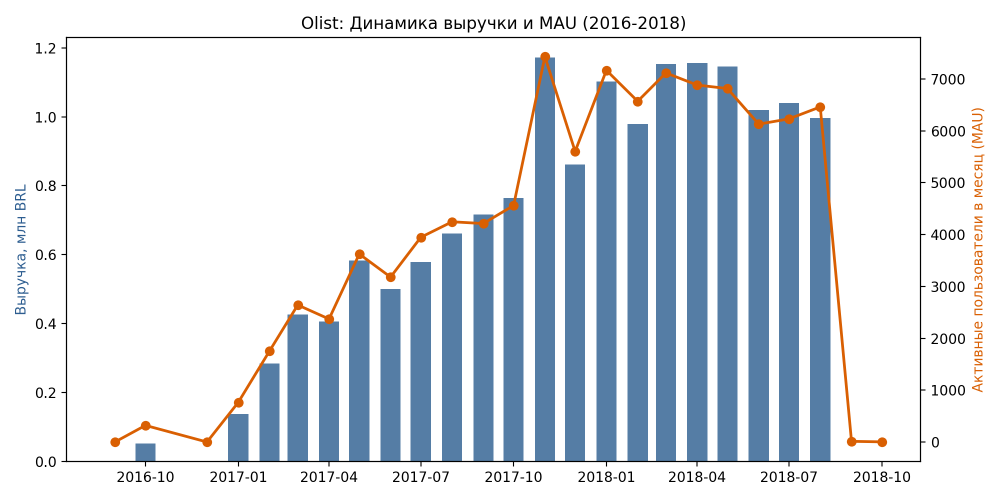
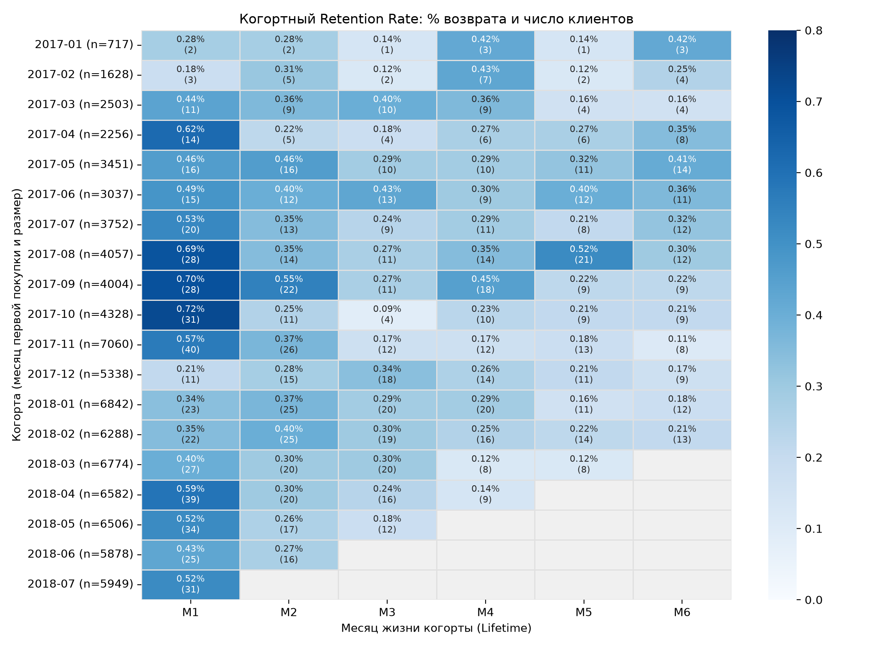
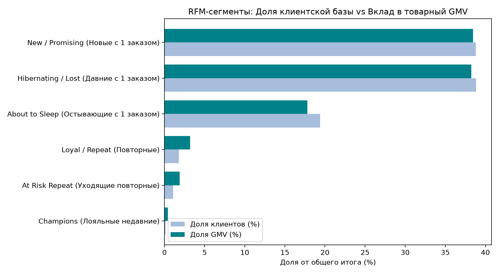

# Аналитика электронной коммерции на базе Olist (PostgreSQL & Python)

Проект продуктовой и финансовой аналитики маркетплейса **Olist** (100 тыс. заказов в Бразилии за 2016–2018 гг.). Включает полный ETL-пайплайн загрузки сырых данных в PostgreSQL, расчёт SQL-витрин бизнес-метрик, когортный анализ удержания и адаптированную RFM-сегментацию клиентской базы.

---

## Архитектура данных и методология

1. **Единый стандарт метрики оборота (Товарный GMV):**
   * Во всех отчётах и моделях (помесячная динамика, дневные метрики, RFM-анализ) используется строгий фильтр `order_status = 'delivered'` и окно полных данных **`2017-01-01` — `2018-08-31`** (20 месяцев).
   * **Товарный GMV (`items_gmv`)** считается как чистая стоимость товаров (`SUM(price)` из `order_items`) без учёта логистического сбора (`freight_value`). За анализируемый период товарный GMV составляет **13,18 млн BRL** (с учётом доставки `total_billed_amount` — **15,15 млн BRL**).
2. **Идентификация пользователей:**
   * В Olist поле `customer_id` генерируется для каждого отдельного заказа. Для отслеживания реальных возвратов и когорт в качестве первичного ключа клиента используется `customer_unique_id` (в схеме БД — `user_id`).
3. **Когортный анализ без искажений на границах окна:**
   * Месяц первой покупки (`cohort_month`) определяется по всей истории доставленных заказов (включая 2016 год), чтобы клиенты 2016 года не попадали ложно в новые когорты 2017 года.
   * Неполные периоды в правом нижнем углу матрицы (выходящие за август 2018 года) маскируются значением `NULL`, а когорта августа 2018 исключена из матрицы, так как период `M1` для неё не наступил.

---

## Ключевые бизнес-выводы

### 1. Динамика GMV и активных покупателей

* С января 2017 по весну 2018 года ежемесячный товарный GMV вырос со **111 тыс. BRL** до стабильного плато **900–990 тыс. BRL** в месяц.
* Пик пришёлся на ноябрь 2017 года (Чёрная пятница): **996,5 тыс. BRL** чистого GMV (**1,15 млн BRL** с доставкой) и **7 189** активных покупателей.
* В первой половине 2018 года площадка удерживала **6,0–7,0 тыс.** активных покупателей ежемесячно при среднем товарном чеке (`avg_order_gmv`) около **137 BRL**.

### 2. Когортный анализ Retention Rate

* **Экстремально низкий возврат:** Retention первого месяца (`M1`) варьируется в диапазоне **0,18%–0,72%** (средневзвешенный `M1` по когортам составляет **0,48%** — около 420 вернувшихся клиентов из ~87 тыс.). Начиная со второго месяца (`M2–M6`), возврат держится на уровне **0,10%–0,35%** (в ранних когортах 2017 года это соответствует единичным покупкам — 1–5 человек на ячейку).
* **Причина:** около **97%** клиентов совершают на Olist ровно одну покупку за всё время наблюдений. Рост маркетплейса обеспечивался за счёт притока новых покупателей, а не повторных продаж.

### 3. Адаптированная RFM-сегментация

* **Методология:** из-за того, что 97% базы имеют ровно 1 заказ, стандартное разбиение `Frequency` на квантили (`pd.qcut`) неприменимо. В проекте использована гибридная шкала:
  * `Recency` и `Monetary` разбиты на 5 квантилей (`1..5`);
  * `Frequency` разделена дискретно: `1` (1 заказ), `2` (2 заказа), `3` (3 и более заказов).
* **Структура базы (общий GMV = 13,18 млн BRL):**
  * Подавляющую часть выручки формируют однократные покупатели в зависимости от давности визита: сегмент **Hibernating / Lost (Давние с 1 заказом)** даёт ~38% GMV, **New / Promising (Новые с 1 заказом)** — ~38% GMV, **About to Sleep (Остывающие с 1 заказом)** — ~19% GMV.
  * Повторные клиенты (**Champions**, **Loyal / Repeat**, **At Risk Repeat**) суммарно составляют **~3% пользователей**, но генерируют **~5,5% товарного GMV** за счёт кратно более высокого LTV (~240–410 BRL против ~136 BRL у однократных покупателей).

---

## Структура репозитория

```text
├── data/                        # Исходные CSV датасета Olist (в .gitignore)
├── reports/                     # Итоговые аналитические артефакты
│   ├── img/                     # Сгенерированные графики (.png)
│   ├── daily_metrics.csv        # Поденная динамика заказов и GMV
│   ├── monthly_metrics.csv      # Помесячный отчет (GMV, доставка, покупатели)
│   ├── cohort_retention.csv     # Матрица удержания (абсолютные числа и %)
│   └── rfm_segments_summary.csv # Сводная таблица по RFM-сегментам
├── scripts/
│   ├── load_olist_to_pg.py      # Автоматическое создание схемы, COPY-загрузка и выгрузка SQL-витрин
│   ├── rfm_segmentation.py      # Расчет RFM-сегментов напрямую из PostgreSQL
│   └── visualize.py             # Генерация графиков из CSV-витрин
├── sql/
│   ├── 00_init_schema.sql       # DDL-скрипт таблиц и композитных индексов
│   ├── 01_daily_metrics.sql     # Запрос дневных метрик
│   ├── 02_monthly_metrics.sql   # Запрос помесячных метрик
│   └── 03_cohort_retention.sql  # Запрос когортного анализа
├── .gitignore
├── README.md
└── requirements.txt
```

---

## Инструкция по запуску и воспроизведению

1. **Клонируйте репозиторий и установите зависимости:**
   ```bash
   git clone [https://github.com/s3kundant/ecommerce_analytics.git](https://github.com/s3kundant/ecommerce_analytics.git)
   cd ecommerce_analytics
   python3 -m venv venv
   source venv/bin/activate
   pip install -r requirements.txt
   ```

2. **Подготовьте базу данных и исходные файлы:**
   * Создайте пустую базу данных `ecommerce_analytics` в PostgreSQL и укажите параметры подключения в файле `.env` (`DB_USER`, `DB_PASSWORD`, `DB_HOST`, `DB_PORT`, `DB_NAME`).
   * Поместите исходные CSV-файлы датасета Olist (`olist_customers_dataset.csv`, `olist_orders_dataset.csv`, `olist_order_items_dataset.csv`) в папку `data/`.

3. **Запустите ETL-пайплайн и выгрузку SQL-витрин:**
   *(Скрипт сам накатит схему `00_init_schema.sql`, загрузит таблицы через потоковый `COPY` и экспортирует витрины в `reports/`)*
   ```bash
   python3 scripts/load_olist_to_pg.py
   ```

4. **Рассчитайте RFM-сегментацию:**
   ```bash
   python3 scripts/rfm_segmentation.py
   ```

5. **Сгенерируйте графики:**
   ```bash
   python3 scripts/visualize.py
   ```